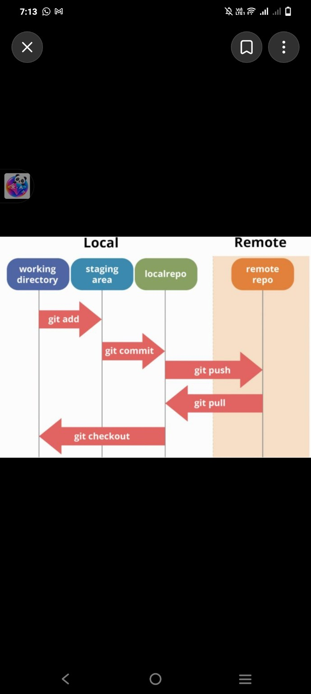
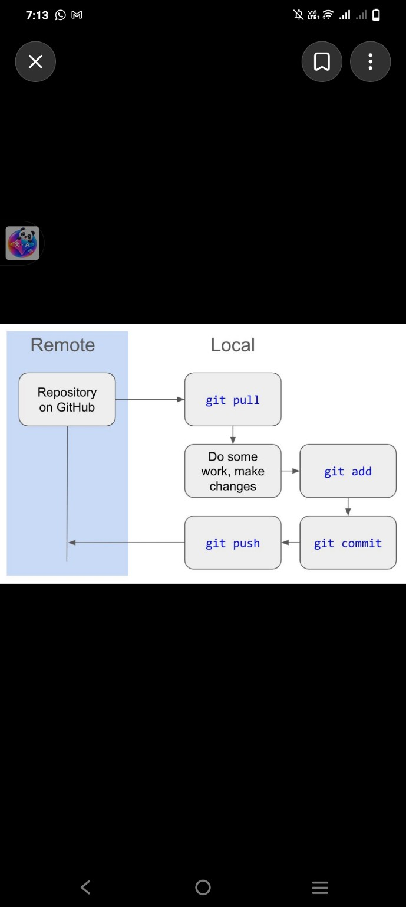
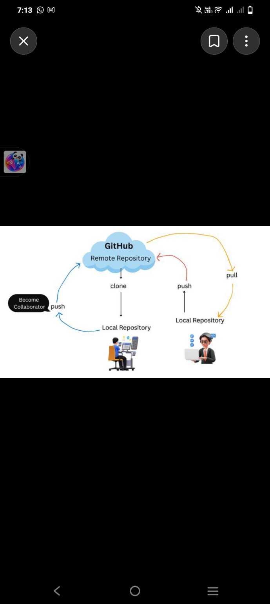
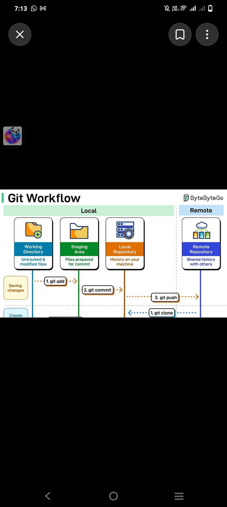
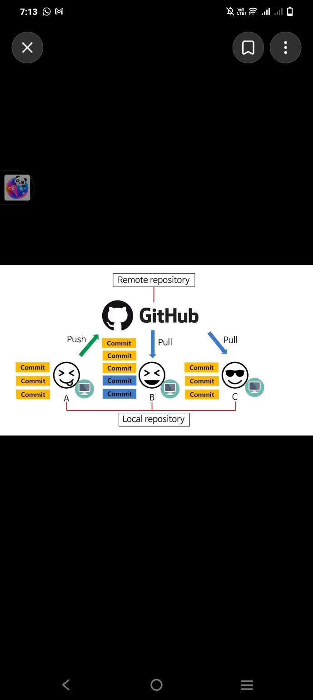
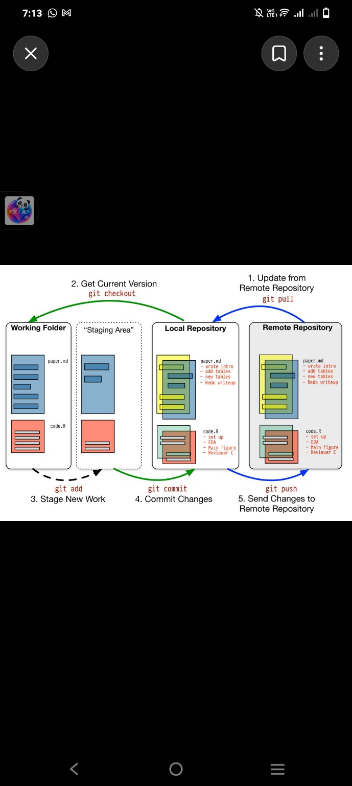
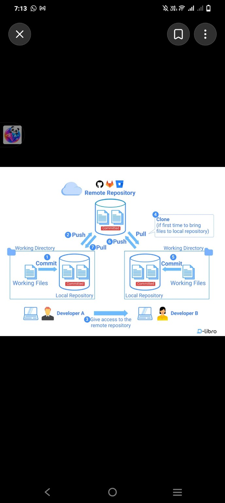

# Git اور GitHub Workflow — AlinGo Device Connect Modular Server

یہ گائیڈ Git کے روزمرہ استعمال، مقامی فائلوں، Staging Area، Local Repository اور GitHub کی Private Remote Repository کی وضاحت کرتی ہے۔ ساتھ سات تصویری خاکے بھی شامل ہیں۔

## 1۔ بنیادی اصطلاحات

| اصطلاح | وضاحت |
|---|---|
| Working Directory | وہ فولڈر جہاں اصل کوڈ اور دستاویزات میں تبدیلی کرتے ہیں۔ |
| Staging Area | وہ منتخب تبدیلیاں جو اگلے commit میں شامل ہوں گی۔ |
| Local Repository | اسی ڈیوائس کی `.git/` تاریخ اور commits۔ |
| Remote Repository | GitHub پر موجود مشترکہ repository۔ |
| Commit | منتخب تبدیلیوں کا مقامی محفوظ snapshot۔ |
| Branch | کام کی الگ لائن؛ اس پروجیکٹ کی مرکزی branch `main` ہے۔ |

`git add` فائل GitHub پر نہیں بھیجتا؛ یہ صرف staging میں رکھتا ہے۔ `git commit` مقامی تاریخ میں snapshot بناتا ہے۔ `git push` اسے GitHub پر بھیجتا ہے।

## 2۔ روزمرہ کام کا مکمل سلسلہ

1. Working Directory میں کوڈ تبدیل کریں۔
2. `git status -sb` سے تبدیلیاں دیکھیں۔
3. `git diff` سے غیر staged تبدیلیاں دیکھیں۔
4. منتخب فائلیں `git add` سے stage کریں۔
5. `git diff --cached` اور `git diff --cached --check` سے staged تبدیلیاں جانچیں۔
6. `git commit -m "Describe the change"` سے مقامی commit بنائیں۔
7. `git push` سے GitHub پر بھیجیں۔



## 3۔ دوسرے آلے پر کام

اگر repository پہلے سے اس آلے پر موجود ہے تو کام شروع کرنے سے پہلے:

```bash
git pull --ff-only
```

اگر پہلی بار نیا آلہ ہے تو:

```bash
git clone git@github.com:empowerdeveloprs/AlinGo-Device-Connect-Modular-Server.git
cd AlinGo-Device-Connect-Modular-Server
```

Private repository کے لیے اس آلے کی SSH key GitHub اکاؤنٹ میں مجاز ہونی چاہیے۔





## 4۔ اہم Git commands

```bash
git status -sb
git diff
git diff --cached
git add README-UR.md docs/ tests/
git diff --cached --check
git commit -m "Describe the change"
git push
git pull --ff-only
git log --oneline -5
git branch --show-current
```

`git add` میں صرف جائزہ لی ہوئی فائلیں شامل کریں۔ `git add .` آسان ہے مگر غیر متعلقہ یا حساس فائلیں بھی stage کر سکتا ہے۔

## 5۔ Staging Area کا فائدہ

ایک ہی وقت میں کئی فائلیں تبدیل ہو سکتی ہیں، مگر اگلے commit میں صرف منتخب فائلیں شامل کی جا سکتی ہیں۔ اسی لیے commit سے پہلے `git status`، `git diff --cached --stat` اور `git diff --cached --check` دیکھیں۔



## 6۔ Collaborators اور متعدد developers

Repository owner GitHub Settings میں قابل اعتماد افراد کو collaborator access دے سکتا ہے۔ ہر developer repository clone کرتا ہے، تازہ تبدیلیاں pull کرتا ہے، اپنا کام commit کرتا ہے اور مجاز ہونے پر push کرتا ہے۔ ٹیم کے کام میں الگ branch اور Pull Request بہتر طریقہ ہے۔ ایک ہی جگہ متضاد تبدیلیوں سے merge conflict آ سکتا ہے؛ اسے فائل کا جائزہ لے کر حل کریں۔







## 7۔ AlinGo پروجیکٹ کے حفاظتی اصول

- اصل `.env`، passwords، tokens، private keys اور credentials commit نہ کریں۔
- `instance/*.db` اور مقامی database فائلیں GitHub سے باہر رکھیں؛ ان کا الگ محفوظ backup رکھیں۔
- `.venv/`، `__pycache__/`، runtime logs اور generated uploads غیر ضروری طور پر commit نہ کریں۔
- `.env.example` میں صرف فرضی placeholders اور غیر خفیہ configuration رکھیں۔
- اہم تبدیلی کے بعد tests چلائیں:

```bash
./.venv/bin/python -m unittest discover -s tests -q
```

- Private repository بھی secrets رکھنے کی جگہ نہیں؛ اس کا مطلب صرف محدود رسائی ہے۔
- `git push --force`، `git reset --hard` یا غیر واضح checkout commands استعمال کرنے سے پہلے ان کے اثرات سمجھیں۔
- `git checkout` کئی کام کرتا ہے؛ branch بدلنے کے لیے `git switch` اور فائل بحال کرنے کے لیے `git restore` زیادہ واضح متبادل ہیں۔

## 8۔ اس repository کی درج شدہ حالت

اس گائیڈ کی تیاری کے وقت دستیاب گفتگو کے مطابق:

- Repository: `empowerdeveloprs/AlinGo-Device-Connect-Modular-Server`
- Visibility: Private
- Branch: `main`
- ابتدائی commit: `40bee4c`
- ابتدائی commit میں 34 فائلیں
- مقامی database commit میں شامل نہیں
- آخری رپورٹ شدہ ٹیسٹ: 43 کامیاب

یہ حالت بدل سکتی ہے؛ تازہ صورتحال کے لیے `git status -sb`، `git log -1 --oneline` اور GitHub دیکھیں۔

## 9۔ مکمل نقشہ

```text
پہلی بار: GitHub → git clone → Local working directory

ہر کام:
git pull --ff-only
       ↓
فائلوں میں تبدیلی
       ↓
git status / git diff
       ↓
git add (منتخب فائلیں)
       ↓
git diff --cached --check
       ↓
git commit
       ↓
git push
       ↓
GitHub Remote Repository
```

تمام سات فراہم کردہ تصویری خاکے `docs/images/git-workflow/` میں شامل ہیں۔
